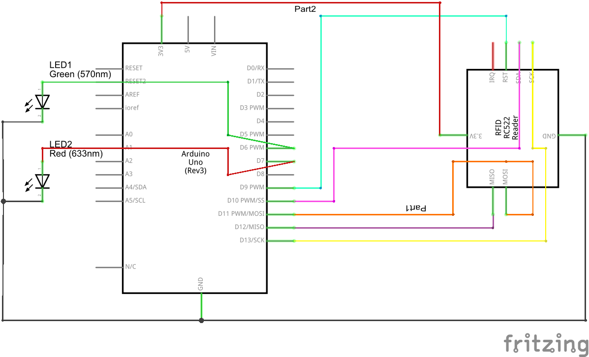

# ESP32 Voting Hardware Diagnostic & Bench Testing Suite

> Standalone diagnostic test firmware for validating tactile button arrays, pull-down resistor logic, and audio transducer response on ESP32-based voting systems.

Before deploying cloud-connected electronic voting firmware, hardware developers must ensure signal integrity, verify debouncing parameters, and test wiring harness continuity. This diagnostic firmware provides an isolated test environment without requiring Wi-Fi or database connections.



---

## Features

- **Isolated Hardware Diagnostic:** Zero Wi-Fi, cloud, or library dependencies; compiles instantly and executes completely in silicon.
- **Button Transition Detection:** Detects clean `LOW → HIGH` state transitions using internal `INPUT_PULLDOWN` configuration.
- **Acoustic Feedback Testing:** Drives GPIO 25 active buzzer with a precise 200 ms audible pulse upon registered press.
- **Real-Time Serial Telemetry:** Streams active button press diagnostics over UART at 115200 baud for immediate bench inspection.

---

## Hardware Pin Mapping

| Button / Line | ESP32 GPIO | Configuration | Function |
|---|---|---|---|
| **Button 1** | `GPIO 13` | `INPUT_PULLDOWN` | Diagnostic Button #1 |
| **Button 2** | `GPIO 14` | `INPUT_PULLDOWN` | Diagnostic Button #2 |
| **Button 3** | `GPIO 27` | `INPUT_PULLDOWN` | Diagnostic Button #3 |
| **Button 4** | `GPIO 26` | `INPUT_PULLDOWN` | Diagnostic Button #4 |
| **Buzzer** | `GPIO 25` | `OUTPUT` | Active Buzzer Trigger |

Refer to [`docs/schematic.png`](docs/schematic.png) for breadboard pinout and wiring schematics.

---

## Bench Testing Instructions

1. Connect the ESP32 board to your development workstation via USB.
2. Open `voting_hardware_test.ino` in Arduino IDE.
3. Select board **ESP32 Dev Module** and set baud rate to **115200**.
4. Upload the sketch.
5. Open the Serial Monitor. Press each button individually:
   ```
   Voting buttons test started!
   Button 1 pressed!
   Button 2 pressed!
   Button 3 pressed!
   Button 4 pressed!
   ```
   Each press should generate a single 200 ms beep and a single line on the monitor. If multiple lines appear per single tap, adjust the delay threshold for noisy switches.

---

## License

MIT License.
